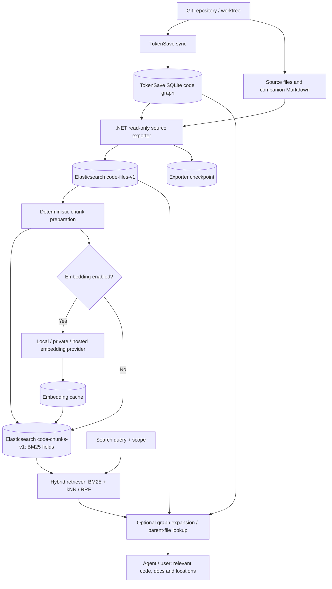

# Privacy-First Code Search and RAG: TokenSave + Elasticsearch + Pluggable Embeddings

**Architecture and research summary**  
**Date:** 24 October 2026  
**Status:** Proposed architecture and implementation plan; not a completed or benchmarked system  
**Primary focus:** C#/.NET repositories, with support for other languages through TokenSave

---

## Executive summary

The objective is to build a reusable code intelligence and retrieval system that can work on customers' source repositories, including privacy-sensitive projects. It should support both **strictly local/private processing** and **optional hosted embedding APIs** when a customer explicitly permits code to leave their infrastructure. The production hardware is unknown, so deployment must not assume a dedicated GPU.

The architecture we converged on is:

1. **TokenSave** analyzes source code using Tree-sitter and maintains a local SQLite/libSQL graph of files, symbols, references, and companion Markdown documentation.
2. A **.NET read-only exporter** reads TokenSave's database and the original source files, translates them into a versioned, canonical **file-level source index** in Elasticsearch, and tracks synchronization progress.
3. A deterministic **chunk preparation pipeline** turns files and TokenSave symbols into method-, class-, and documentation-level search units.
4. **Elasticsearch** stores the chunks as independently searchable documents with BM25 fields and, where enabled, dense vectors.
5. A configurable **embedding service** uses either a local open-weight model, a private inference server, or a commercial API such as Voyage Code 4.
6. A **hybrid retriever** combines lexical and semantic results (e.g. with RRF), and may expand relevant results through TokenSave's graph before returning context to an agent.
7. An **exporter checkpoint and embedding cache** make the pipeline incremental: changed files are inspected, changed chunks are reindexed, and only changed embedding inputs need new embeddings.
8. **Branches and worktrees** are isolated logical search scopes while identical code and embeddings can be reused.

**Recommended first deliverable:** a small .NET exporter that ingests TokenSave symbols plus source into `code-files-v1` and `code-chunks-v1`, initially with BM25 only, then adds one local embedding provider and one hosted provider.

> **Evidence boundary:** TokenSave capabilities, model availability and Elasticsearch behavior below refer to linked documentation. Elasticsearch index layouts, hashes, APIs, checkpoint tables and branch deduplication are **our design proposals**, not built-in TokenSave features. Verify actual TokenSave database schema and Elasticsearch version before implementing. No C#-specific model winner has yet been independently demonstrated by our own benchmark.

---

## 1. Goals and constraints

### Functional goals

- High-quality search over **C# code**, with possible extension to all languages TokenSave supports.
- Support developer and AI-agent questions such as:
  - “Find the retry logic for HTTP calls.”
  - “Where is payment idempotency enforced?”
  - “Which implementation of this interface handles this request?”
  - “What code will be affected if this method changes?”
  - “Find the code described by this architecture document.”
- Return **precise code locations**, signatures, source snippets, relevant documentation and optional graph relationships.
- Support full-file retrieval as well as smaller method/class/documentation chunks.
- Update incrementally as repository files and documentation change.
- Keep searches isolated to a selected **repository / branch / worktree / snapshot**.
- Avoid repeated indexing and embedding of unchanged content shared across branches.
- Keep the embedding implementation behind a .NET abstraction so the customer can choose a local or hosted model.

### Nonfunctional goals

- **Privacy-first:** no source transmission to external inference services unless explicitly authorized and configured.
- Commercially viable licensing for local models and dependencies.
- No requirement for a customer-owned discrete GPU.
- Observability, crash recovery, idempotent retries and auditable synchronization.
- Ability to rebuild chunk or vector indexes without re-running source parsing.
- Language-agnostic architecture with additional C# enrichment possible later via Roslyn.

### Available experimentation hardware

- **MacBook Air M5 with 32 GB unified memory** for local experiments.
- A Windows system with **RTX 5060 Ti 16 GB + RTX 3070 8 GB**, suitable for local GPU benchmarks.
- Customer hardware is unknown, so CPU-based and remote/private-server deployment modes must remain available.

The MacBook's memory makes the smaller open-weight candidates plausible for experimentation. Inference speed and compatibility with PyTorch MPS or MLX must be measured rather than assumed.

---

## 2. Embedding model research

### 2.1 Important selection principle

**General embedding leaderboards do not necessarily predict code retrieval quality.** Code-specialized models can outperform larger general-purpose embedding models on code-retrieval benchmarks. Benchmark results also may not transfer to C# or to our chunking and query patterns.

We need separate tests for:

- Natural-language → source code.
- Code → similar code.
- Code → documentation.
- Issue / bug description → implementation.
- Repository-aware retrieval and dependency/context expansion.

CoREB is a useful public reference, but its evaluated language mix does not establish the best C# model. Claims from provider-specific benchmarks must also be distinguished from independent results.

### 2.2 Local / open-weight shortlist

| Model | Intended role | General assessment | Licensing / deployment caveat |
|---|---|---|---|
| [C2LLM-0.5B](https://huggingface.co/codefuse-ai/C2LLM-0.5B) | Primary small local candidate | Code-specific, attractive quality/size tradeoff | Apache 2.0; model card uses custom code (`trust_remote_code`), requiring review |
| [BGE-Code-v1](https://huggingface.co/BAAI/bge-code-v1) | Primary challenger | Code-specific; strong published retrieval results | Apache 2.0; test C# directly |
| [C2LLM-7B](https://huggingface.co/codefuse-ai/C2LLM-7B) | Larger local quality reference | Determines whether more model capacity pays off | Apache 2.0; more demanding memory/inference |
| [Nomic CodeRankEmbed](https://huggingface.co/nomic-ai/CodeRankEmbed) | Small baseline | Good low-resource benchmark candidate | MIT; confirm exact runtime requirements |
| [Nomic Embed Code](https://huggingface.co/nomic-ai/nomic-embed-code) | Additional larger option | Alternative code model | Confirm weight/runtime packaging |
| [Jina Code Embeddings 1.5B](https://huggingface.co/jinaai/jina-code-embeddings-1.5b) | Research-only comparison unless licensed | Strong reported code retrieval | Published weights use CC BY-NC 4.0; **not automatically suitable for commercial customer deployment** |

**Preferred first local comparisons:** C2LLM-0.5B, BGE-Code-v1 and CodeRankEmbed; add C2LLM-7B to determine the incremental quality gain of a much bigger model.

Important naming clarification from our discussion: the Nomic **CodeRankEmbed** model and the **C2LLM** family are different products. Some secondary benchmark labels have been inconsistent; identify models using the actual publisher/model IDs rather than ambiguous leaderboard names.

### 2.3 Hosted / closed-model shortlist

| Model | Why test it | Constraint |
|---|---|---|
| [Voyage Code 4 (`voyage-code-4`)](https://docs.voyageai.com/docs/embeddings) | Best hosted **starting candidate** for agentic code retrieval | External code transfer; provider data-handling review required |
| [Cohere Embed 5 Pro (`embed-v5.0-pro`)](https://docs.cohere.com/changelog/embed-v5) | Newer enterprise retrieval challenger; 128K context; shared space with Fast | Need independent C# comparison, pricing/deployment review |
| [Mistral Codestral Embed](https://docs.mistral.ai/studio/knowledge-rag/embeddings/code_embeddings) | Dedicated code embedding challenger | Not publicly downloadable as an ordinary open-weight model |
| [Gemini Embedding 2](https://ai.google.dev/gemini-api/docs/models/gemini-embedding-2) | Useful non-code-specialized comparator | Hosted processing and pricing terms |
| [OpenAI text-embedding-3-large](https://platform.openai.com/docs/guides/embeddings) | Established general-purpose baseline | Hosted processing and privacy terms |

**Voyage Code 4** was introduced in August 2026 as a code retrieval model for coding agents, with a listed price of **$0.12 per million input tokens** at announcement, 32K context, and configurable output dimensions. Its published gains are **vendor-reported**, not proof of C# superiority. [Announcement](https://blog.voyageai.com/2026/08/13/voyage-code-4/).

**Cohere Embed 5** was announced in September 2026. The Pro and Fast variants share an embedding space; Cohere recommends indexing with Pro and querying with Fast. This **does not** imply interoperability with other providers' models. [Cohere release notes](https://docs.cohere.com/changelog/embed-v5).

**Codestral Embed is not simply “an open Mistral model.”** Mistral's model catalog classifies it as a **Premier** embedding model. API usage and enterprise private deployment are possibilities, but publicly downloadable ordinary self-hosted embedding weights are not advertised. Do not confuse it with open-weight *code generation* versions of Codestral. [Mistral model catalog](https://docs.mistral.ai/models) · [Private deployment announcement](https://mistral.ai/news/codestral-25-08/).

Pricing, model terms and availability change: recheck before purchasing or committing to a customer agreement.

### 2.4 Evaluation instead of guessing the winner

Use one fixed C# retrieval dataset across all providers, with identical source extraction, chunking rules and relevance judgments. Measure **Recall@5 / Recall@10, MRR@10, nDCG@10, p50/p95 query latency, indexing throughput, resource usage, vector storage cost, hosted API cost**, and failure rate.

Do not benchmark only the embedding vectors: test end-to-end BM25-only, vector-only, hybrid, and hybrid-plus-graph variants.

---

## 3. Why TokenSave is a useful structural foundation

[TokenSave](https://github.com/aovestdipaperino/tokensave) is a local code intelligence and MCP tool. Rather than generating embeddings for everything by default, it constructs an **indexed structural representation** with Tree-sitter parsers, code symbols, file metadata, and relationships such as calls/implements/extends/contains.

It supports **C#** and numerous other languages, with language availability dependent on the installed build/tier. Its local code graph can support:

- Method/class/interface discovery.
- Qualified symbol names, signatures, locations and documentation.
- Call graphs, inheritance and implementations where resolution succeeds.
- Potentially relevant dependency neighborhoods and impacted code.
- References from companion Markdown to source files.
- File-level incremental change detection.

TokenSave complements embeddings: **structural graph + precise lexical search** excel at finding exact symbols and relationships; **vectors** excel at retrieving code described indirectly in natural language.

### C# caveat

TokenSave's extraction and resolution are based on Tree-sitter and custom logic, **not a full Roslyn semantic compilation**. Validate overloads, extension methods, partial classes, generics, aliases and dependency-injection wiring. A future optional Roslyn enrichment stage can add compiler-level symbol IDs and type relationships without replacing TokenSave for other languages.

### TokenSave SQLite database

The documented project database is located under:

```text
<project>/.tokensave/tokensave.db
```

Relevant documented tables include:

| Table | Role in our system |
|---|---|
| `files` | Relative path, SHA-256 `content_hash`, indexing metadata and file-level change detection |
| `nodes` | Symbol kind, name, qualified name, file path, line ranges, signature and other metadata |
| `edges` | Directed structural and reference relations between nodes |
| `unresolved_refs` | Unresolved cross-file references |
| `ambiguous_calls` | Ambiguous call-site candidates; important for confidence reporting |
| `metadata` | Internal last-sync and other metadata, **not our export checkpoint** |
| `nodes_fts` | Internal FTS5 symbol lookup |
| `vectors` | Optional internal vectors; not the planned authoritative Elasticsearch vector store |

The database supports local indexing and is configured for WAL/concurrent readers. **Never write exporter state into TokenSave's own schema.** Pin a compatible version and detect schema changes before import.

Official schema reference: [TokenSave Index Design](https://github.com/aovestdipaperino/tokensave/blob/master/docs/INDEX-DESIGN.md).

### Access options

1. **Read-only direct SQLite adapter:** best initial route for bulk ingestion and full metadata access; schema-coupled.
2. **TokenSave CLI/MCP:** good for integrated code navigation, but potentially inefficient for bulk export.
3. **Future upstream JSONL/export command:** best long-term interface if supported or contributed.

For source bodies, use verified TokenSave source ranges and read the corresponding revision of the actual source file. Do not assume every symbol's complete code body lives in the primary `nodes` row. Validate line-ending, encoding, byte offset and snapshot consistency.

---

## 4. Companion Markdown: make documentation first-class searchable content

TokenSave documents two companion-documentation conventions:

### Sidecar file

```text
src/Services/PaymentService.cs
src/Services/PaymentService.readme.md
```

The `*.readme.md` file is automatically associated with its matching source file by name.

### Central documentation folder

```text
tokensave-docs/payment-processing.md
```

```markdown
---
applies_to:
  - "src/Payments/**/*.cs"
  - "src/Orders/OrderService.cs"
---

# Payment processing

Payment retries must preserve idempotency. An authorization failure
must not commit an order.
```

The default `tokensave-docs/` directory can be renamed via `docs_dir` in `.tokensave/config.json`. The `tokensave_doc` tool returns associated docs, covered files and a `doc_stale` signal. The documented association granularity is **whole-document / whole-file**, not an individual method or Markdown heading.

Reference: [TokenSave User Guide — Companion Markdown](https://github.com/aovestdipaperino/tokensave/blob/master/docs/USER-GUIDE.md).

### Our proposed indexing behavior

- Index Markdown independently as **documentation chunks**, normally split by headings/sections.
- Store `doc_id`, `documentation_path`, and the TokenSave-derived `applies_to` file associations.
- Make documentation retrievable with BM25 and vectors.
- Link documentation hits to their covered source files and then relevant symbols.
- Optionally add small relevant excerpts to a code symbol's embedding input, **but avoid blindly concatenating huge documentation files**.
- Include documentation dependencies in the incremental indexer's invalidation logic.
- Expose staleness to the retriever/agent; don't automatically discard useful but stale documents.

---

## 5. Proposed end-to-end architecture



**Responsibility boundaries:**

- **TokenSave:** language analysis, symbols, relationships and its own source synchronization.
- **.NET exporter:** durable ingestion, prepared source representation, chunking, hashes, embeddings and failure handling.
- **Elasticsearch:** lexical/vector indexing, filtering and retrieval.
- **Retrieval coordinator:** branch authorization, candidate fusion, graph expansion, context packing.

### Two initial Elasticsearch indexes

**1. `code-files-v1`: canonical prepared source**

- One immutable **file revision** per document.
- Full source text (if permitted), file path, language, content hash, structured symbol outline, companion-doc associations.
- Index-preparation metadata, extractor version and provenance.
- Searchable directly for file-level lookup and used as **rebuild input** for chunk generation.
- May hold a file overview; full-file vectors are optional, not assumed useful for very large code files.

**2. `code-chunks-v1`: retrieval units**

- One independently searchable logical chunk (method, class/API overview, property group, long-method fragment, document section, file overview).
- BM25 fields for code, identifier, signature, comments and Markdown.
- Optional dense vector generated by the configured model.
- References back to `file_revision_id` and source location.
- Explicit repo/scope identifiers or references for branch/worktree visibility.

**Possible third logical index:** `code-vectors-{embedding-profile}` as a reusable embedding cache. Start with a separate simple checkpoint/cache store or vector field on chunks; split the vector store only when experiments justify extra complexity.

### Why not nested chunks or Elasticsearch parent/child?

Independent chunk documents are easier to update when one method changes. A nested object forces a rewrite of its containing Elasticsearch document; parent/child joins add search complexity and shard-routing constraints. Keep explicit IDs and perform parent-file lookup in .NET after retrieval.

### Full-file indexing still matters

An entire class/file can help answer architectural or file-discovery questions and supply context to an agent after smaller matching chunks have been retrieved. **Do not rely exclusively on file-size embeddings**: very large code files can dilute relevance. Keep file-overview chunks and a separately searchable canonical file record.

---

## 6. Proposed Elasticsearch data contracts

All JSON in this section is an **illustrative application contract**, not TokenSave's database schema.

### 6.1 File revision example

```json
{
  "file_revision_id": "sha256:file-revision-example",
  "repository_id": "payments",
  "path": "src/Services/PaymentService.cs",
  "language": "csharp",
  "content_hash": "sha256:raw-source-example",
  "extractor_profile": "tokensave-v1",
  "source_code": "public sealed class PaymentService { ... }",
  "symbols": [
    {
      "source_node_id": "tokensave-node-example",
      "kind": "method",
      "qualified_name": "MyApp.Payments.PaymentService.ProcessAsync",
      "start_line": 45,
      "end_line": 92
    }
  ],
  "documentation_paths": [
    "src/Services/PaymentService.readme.md"
  ]
}
```

A file revision's identity must account for **repository authorization scope, path (or a separately managed path occurrence), raw content and extraction/configuration version** as appropriate. Content-addressed cross-path deduplication is possible but must not accidentally collapse distinct locations or tenants.

### 6.2 Chunk example

```json
{
  "chunk_id": "sha256:chunk-example",
  "file_revision_id": "sha256:file-revision-example",
  "repository_id": "payments",
  "scope_id": "worktree:agent-a",
  "language": "csharp",
  "kind": "method",
  "path": "src/Services/PaymentService.cs",
  "qualified_name": "MyApp.Payments.PaymentService.ProcessAsync",
  "signature": "Task<PaymentResult> ProcessAsync(...) ",
  "start_line": 45,
  "end_line": 92,
  "code": "public async Task<PaymentResult> ProcessAsync(...) { ... }",
  "documentation": "Processes payment using an idempotency key.",
  "chunk_hash": "sha256:searchable-fields-example",
  "embedding_input_hash": "sha256:embedding-input-example",
  "embedding_profile": "voyage-code-4-d1024-v1",
  "embedding": [0.012, -0.031, 0.045]
}
```

The vector is intentionally shortened: real vector dimensions must match the model and Elasticsearch mapping. Do not mix different model spaces inside one vector field.

### 6.3 Initial chunk-index mapping (modern ES 8.x/9.x only)

```json
PUT code-chunks-v1
{
  "mappings": {
    "properties": {
      "repository_id": { "type": "keyword" },
      "scope_id": { "type": "keyword" },
      "chunk_id": { "type": "keyword" },
      "file_revision_id": { "type": "keyword" },
      "path": { "type": "keyword" },
      "language": { "type": "keyword" },
      "kind": { "type": "keyword" },
      "qualified_name": {
        "type": "text",
        "fields": { "exact": { "type": "keyword", "ignore_above": 2048 } }
      },
      "signature": { "type": "text" },
      "code": { "type": "text" },
      "documentation": { "type": "text" },
      "start_line": { "type": "integer" },
      "end_line": { "type": "integer" },
      "chunk_hash": { "type": "keyword" },
      "embedding_input_hash": { "type": "keyword" },
      "embedding_profile": { "type": "keyword" },
      "embedding": {
        "type": "dense_vector",
        "dims": 1024,
        "index": true,
        "similarity": "cosine"
      }
    }
  }
}
```

**Version note:** the mapping and approximate kNN features depend on the customer's Elasticsearch version and distribution. Elasticsearch 7.x and some editions require different vector search approaches. Avoid pretending the code above is portable to every ES version; verify supported APIs before deployment.

### Field analyzers

For exact C# identifiers, keep both `keyword` and analyzed fields. Test camelCase/PascalCase splitting (`ProcessPaymentAsync` → `process`, `payment`, `async`), qualified-name punctuation, underscores, generics and namespace separators, while keeping original tokens for exact matching. Boost names and signatures more than long bodies for many symbol-finding queries.

---

## 7. Chunk preparation strategy

**Default unit:** semantically meaningful source entities, not arbitrary fixed-length windows.

| Input entity | Suggested chunk |
|---|---|
| Small/medium method | Whole method with namespace, type and signature context |
| Large method | Multiple statement/block-aligned chunks with repeated header context |
| Class/interface | API overview; do not duplicate the entire method body corpus |
| Properties/fields | Separate or grouped by related members |
| File | File overview and full canonical source accessible separately |
| `.readme.md` sidecar | Documentation chunks, linked to source file |
| Central Markdown | Heading/section chunks, linked to `applies_to` files |
| Non-C# languages | Use TokenSave's node types and language-specific segmentation rules |

Possible embedding input:

```text
Language: C#
Path: src/Services/PaymentService.cs
Namespace: MyApp.Payments
Type: PaymentService
Symbol: ProcessAsync
Signature: Task<PaymentResult> ProcessAsync(...)
XML documentation: ...
Related sidecar documentation excerpt: ...
Implementation:
<source code>
```

Use a **versioned deterministic chunker**. A tentative target of **300–800 model tokens per chunk** is a starting point for experiments, not a fixed best practice. Respect complete method boundaries where possible; tokenize using the actual embedding model tokenizer if available.

The chunk contract must record:

- Source location and source revision.
- Symbol identity and chunk ordinal/extent.
- Text used for BM25.
- Exact input text used for embedding.
- Chunker version, enrichment rules and model-specific input preparation.
- Associated docs, hashes and graph-provenance references.

This design allows the chunker and embedding models to change independently of TokenSave extraction.

---

## 8. Incremental TokenSave → Elasticsearch synchronization

### 8.1 Two different kinds of synchronization

**TokenSave → TokenSave DB:** its own `tokensave sync` hashes source files and updates its graph.

**TokenSave DB → Elasticsearch:** our exporter must remember what successfully reached Elasticsearch. TokenSave's `metadata.last_sync_at` is **not** a reliable cursor for an independent downstream consumer, and its command diagnostics should not be treated as a durable event log of all changes since a previous Elasticsearch export.

**Answer to the central question:** yes, the exporter should keep a **manifest of file hashes last successfully published to Elasticsearch**. It can reuse TokenSave's SHA-256 values instead of re-hashing each source file merely to detect change.

### 8.2 Suggested exporter checkpoint database

Use a **separate SQLite file**, or an equivalent durable store if distributed coordinators are required:

```sql
CREATE TABLE exported_files (
    scope_id        TEXT NOT NULL,
    path            TEXT NOT NULL,
    content_hash    TEXT NOT NULL,
    export_version  TEXT NOT NULL,
    PRIMARY KEY (scope_id, path)
);

CREATE TABLE exported_chunks (
    scope_id             TEXT NOT NULL,
    chunk_occurrence_id  TEXT NOT NULL,
    file_path            TEXT NOT NULL,
    chunk_hash           TEXT NOT NULL,
    embedding_input_hash TEXT NOT NULL,
    embedding_profile    TEXT NOT NULL,
    PRIMARY KEY (scope_id, chunk_occurrence_id, embedding_profile)
);
```

In production, also track published snapshot ID, job status, error/retry count, index generation and extractor/chunker versions. The checkpoint is committed **only after** the corresponding Elasticsearch document writes/deletions succeed.

### 8.3 Detect changed or added files

With the TokenSave DB attached as `main`, and the exporter DB attached as `exporter`:

```sql
SELECT
    f.path,
    f.content_hash,
    CASE WHEN e.path IS NULL THEN 'added' ELSE 'modified' END AS change_type
FROM main.files AS f
LEFT JOIN exporter.exported_files AS e
    ON e.scope_id = @scope_id
   AND e.path = f.path
WHERE e.path IS NULL
   OR e.content_hash <> f.content_hash
   OR e.export_version <> @export_version;
```

### 8.4 Detect deleted files

```sql
SELECT e.path
FROM exporter.exported_files AS e
LEFT JOIN main.files AS f ON f.path = e.path
WHERE e.scope_id = @scope_id
  AND f.path IS NULL;
```

The deletion query is essential: after TokenSave removes a file, no current `files` row remains to explain what Elasticsearch should delete. A single last-sync timestamp cannot solve that.

### 8.5 Three useful hashes

| Hash | Input | Purpose |
|---|---|---|
| `file_hash` | Raw file bytes as recorded by TokenSave | Find which files need reassessment |
| `chunk_hash` | All versioned searchable fields/metadata that affect a chunk document | Decide whether its Elasticsearch BM25 document changes |
| `embedding_input_hash` | Exact normalized string or sequence sent to a particular embedding model | Decide whether a vector must be regenerated |

The effective **embedding-cache key** is more than a hash of text:

```text
SHA256(
    authorization_scope +
    provider + model_id + model_revision +
    input_type + output_dimension + normalization_profile +
    embedding_input_bytes
)
```

Where legally permitted, deduplication can be shared within a tenant/repository. **Do not share private chunk text, vectors, or retrieval memberships across customers** simply because the hashes match.

### 8.6 Step-by-step update algorithm

1. Run `tokensave sync` on the relevant worktree or branch index.
2. Obtain a **consistent TokenSave SQLite snapshot** and corresponding source revision/working copy; protect against modifications during export.
3. Diff current `files` metadata against the last-published `exported_files` manifest.
4. For added or changed files, update/reuse the immutable `code-files` document.
5. Rebuild chunk descriptors **only for affected files**, plus files affected by documentation/extraction configuration changes.
6. Compare the new chunk manifest to the last-published chunk manifest.
7. Bulk insert/update changed chunk documents; delete obsolete chunk occurrences.
8. Obtain embeddings **only for new embedding-cache keys**; reuse existing vectors for unchanged embedding input.
9. Reconcile branch/worktree memberships and separately track graph edges that changed outside modified source files.
10. Validate per-item Elasticsearch Bulk API results and apply an idempotent retry protocol.
11. Publish the new logical search snapshot and advance the checkpoint; only then garbage-collect orphaned content when eligible.

**Example:** a 20-method C# file changes in one method and gains another. Rebuild the chunk manifest for that one file, but ideally only the changed/new method inputs need fresh embeddings. If shared documentation changed, additional related inputs may also need recalculation.

### 8.7 The non-obvious invalidation cases

- **Documentation change:** `.readme.md` or central Markdown can change while `.cs` source stays identical. Its own chunks and any code chunks embedding its text must be invalidated.
- **Graph resolution change:** an `edges` row may change because another file changed; do not infer edge correctness solely from the source file's hash. Either reconcile graph exports separately or query TokenSave graph live.
- **Reconfiguration:** changing excludes, supported language tier, chunk strategy or enrichment version must invalidate the appropriate derived state even if source hashes stay the same.
- **File rename/move:** content hashes may match while path-based search fields, scope location and source links change; reuse the vector but update occurrences.
- **Line movement:** TokenSave node IDs may depend on source locations; never rely exclusively on them for stable chunk identity.
- **Process crash:** Elasticsearch and SQLite checkpoints are not one atomic transaction. Use deterministic `_id`s, idempotent retries and commit markers/snapshot publication.
- **Concurrent writes:** never read an inconsistent mixture of graph DB and source-file versions.

### Alternative future improvement: a TokenSave export journal

A durable `index_changes(sequence_id, file_path, change_type, ...)` feed inside TokenSave could allow a downstream exporter to consume change sequences rather than recompare manifests. **This is a proposed enhancement, not a currently established official TokenSave downstream CDC API**. Until then, diffing a small file manifest is reliable and relatively cheap.

---

## 9. Branch and worktree strategy

### 9.1 Native TokenSave behavior

TokenSave supports incremental sync and optional multi-branch tracking. Its branch guide explains that **each tracked branch database is a full graph copy, not a delta**. Git worktrees can each have a local `.tokensave/` index. A long-lived MCP server can remain bound to its startup branch database; restart after switching branches in a multi-branch setup.

Reference: [TokenSave Branching User Guide](https://github.com/aovestdipaperino/tokensave/blob/master/docs/BRANCHING-USER-GUIDE.md).

### 9.2 Recommended default for coding agents

- One TokenSave index per active worktree.
- Usually do **not** additionally enable a separate set of branch databases inside each permanently branch-assigned worktree.
- Keep `repository_id`, `branch_ref`, `worktree_id` and `snapshot_id` separate.
- Treat uncommitted edits as a distinct indexed snapshot even if the Git `HEAD` is identical.
- Never allow query results from a different worktree to leak into the requesting agent's context.

### 9.3 Separate content from occurrences

Two identity concepts matter:

**Content identity:** what the file/chunk actually contains, including index-relevant configuration.

**Occurrence identity:** where that content appears (`tenant`, `repo`, `branch/worktree/snapshot`, path, lines, source symbol).

For example, `PaymentService.ProcessAsync` might have identical code on `main` and two feature branches. We should **embed it once** per authorized embedding profile, while preserving its three occurrences and allowing each scope to search its own state.

### 9.4 Deduplication options

**Option A — simpler MVP**

- One shared logical `code-files` index per customer/security boundary.
- One `code-chunks` index per embedding/index generation with **scope-specific chunk documents**.
- Reuse vectors from a content-addressed cache; duplicate some small chunk metadata/possibly vectors across scopes.
- Query filtering is straightforward and correct.

**Option B — more aggressive optimization**

- Unique chunk content/vector records plus separate `code-occurrences` metadata.
- A scope-to-content membership/overlay structure that resolves branch views before or during retrieval.
- Reduces duplicate content storage but makes **branch-filtered ANN/kNN** more complex.

**Recommendation:** choose Option A initially. Do not trade correctness and authorization isolation for premature elimination of every duplicate Elasticsearch document. Measure index growth before implementing Option B.

### 9.5 Snapshot rules

- `repository_id`: persistent repository identity, not local folder path alone.
- `branch_ref`: human/logical branch ref (can be renamed/rebased).
- `worktree_id`: stable identifier for a working copy.
- `snapshot_id`: immutable manifest of indexed file revisions and relevant preparation configuration; dirty worktrees need a content snapshot, not just a Git commit hash.

Attach index members to a **fully published snapshot**. Queries should always operate against a consistent snapshot rather than partly old and partly new chunk membership.

### 9.6 Cleanup

When a branch/worktree disappears:

- Remove its active occurrence/scope memberships.
- Retain any still-referenced shared content and vectors.
- Garbage-collect unreferenced content only after a grace period/retention policy.
- Run TokenSave branch database cleanup (e.g. `tokensave branch gc`) where appropriate.
- Check for running MCP servers before deleting worktree-local SQLite files.

---

## 10. Hybrid retrieval and graph-aware context assembly

### Retrieval stages

1. Resolve **customer, repository, branch/worktree and authorized snapshot**.
2. Run scoped **BM25 search** over chunk names, qualified names, signatures, documentation and code.
3. If enabled, embed the query with the **matching embedding profile** and run scoped vector kNN.
4. Combine ranked candidates with **Reciprocal Rank Fusion (RRF)** or another evaluated fusion method.
5. Apply optional exact symbol/file-name boosting or reranking.
6. Retrieve parent file, companion Markdown and TokenSave graph neighbors only for the selected top candidates.
7. Pack a bounded context with citations (paths/lines/snapshot provenance) for the user or coding agent.

**Important:** apply scope and authorization filtering to both lexical and vector retrieval **before** fusion; filtering only after ranking can waste top-k slots and risk leaking scope-specific results.

### Elasticsearch license/version caveat

Elasticsearch's native RRF retriever is documented, but licensing varies by product/version/subscription; Elastic's pricing FAQ places RRF hybrid-ranking functionality in Platinum/Enterprise tools. **Provide a fallback that runs BM25 and kNN separately and performs RRF in .NET**. This also helps with customer installations lacking the relevant retriever API.

Links: [RRF retriever](https://www.elastic.co/docs/reference/elasticsearch/rest-apis/retrievers/rrf-retriever) · [Elastic pricing FAQ](https://www.elastic.co/pricing/faq).

### Graph expansion rules

Do not indiscriminately expand every `calls` edge. For example, after retrieving a matching method, select a small number of relevant callers, callees, implemented interfaces, related tests or sidecar docs according to query intent and a strict token budget. Evaluate whether graph expansion improves relevant-code recall rather than just adding text.

---

## 11. Local versus hosted deployment matrix

| Customer environment | Recommended mode |
|---|---|
| Strictly air-gapped or prohibits external source transfer | TokenSave + BM25, optionally local embedding model |
| Workstation without GPU | TokenSave + BM25; small CPU embedding model if acceptable |
| Apple Silicon or customer GPU | TokenSave + local embedding service |
| Private internal servers | TokenSave + self-hosted embedding service, Elasticsearch in customer boundary |
| Hosted embeddings permitted | TokenSave + Voyage Code 4 / Cohere / Mistral APIs behind provider abstraction |
| Large multi-user enterprise | Central indexing/inference service, authz per tenant/repo/snapshot, durable job coordination |

### .NET interfaces (proposed)

Use `Microsoft.Extensions.AI` / `IEmbeddingGenerator` where it fits the provider API, but isolate **document vs query input formatting**, output dimensions, model identity and batching from the chunking code.

Suggested application interfaces:

```csharp
public interface ICodeSourceExporter
{
    Task<ExportBatch> ReadChangesAsync(
        SourceScope scope,
        CancellationToken cancellationToken);
}

public interface ICodeChunker
{
    IReadOnlyList<PreparedChunk> BuildChunks(PreparedFile file);
}

public interface ICodeIndexWriter
{
    Task PublishAsync(
        IndexBatch batch,
        CancellationToken cancellationToken);
}
```

These are conceptual contracts, not compile-ready types. Place typed provider-specific query/document options in a dedicated embedding adapter rather than baking one vendor's format into the schema.

---

## 12. Security and customer privacy

A local model is not sufficient by itself to guarantee privacy: the **entire indexing/search pipeline** processes sensitive code.

Minimum design controls:

- No external embedding/API call unless explicitly enabled for that customer and repository.
- Clear separation between local/private/hosted model profiles and indexes.
- Review retention, training opt-out, data-processing agreement, processing region and subprocessors for each hosted provider.
- Treat **Elasticsearch, TokenSave SQLite, the checkpoint store, embeddings, caches and logs** as potentially confidential source-code data.
- Restrict repository/snapshot visibility through application authorization and data boundaries, not merely UI filters.
- Avoid sending secrets, credentials, generated keys or excluded files to external APIs; include secret-scanning and exclusion policies where appropriate.
- Audit custom Hugging Face code (`trust_remote_code=True`) before execution; pin model revisions and verify artifacts.
- Use network egress restrictions for strict air-gapped deployment.
- TokenSave documents optional anonymous token-counter network requests and version checks; `tokensave disable-upload-counter` disables uploading the counter **but does not prevent all network requests**. Use network controls for a true no-egress environment.
- Avoid cross-tenant deduplication of confidential source payloads or vectors.
- Use encrypted storage, access controls and retention/erasure policies for all derived indexes.

TokenSave privacy documentation: [User Guide — Privacy and Network](https://github.com/aovestdipaperino/tokensave/blob/master/docs/USER-GUIDE.md).

---

## 13. Implementation roadmap

### Phase 0 — verify contract and versions

- Pin TokenSave version/build tier and check actual schema (`sqlite_master`, table columns, schema version if present).
- Record supported languages and actual C# node kinds.
- Confirm companion documentation and worktree behavior on representative repositories.
- Fix minimum supported Elasticsearch versions and licensing assumptions.
- Create a small public/test C# repository with methods, documentation and branch changes.

**Deliverable:** schema adapter test suite + fixture repository.

### Phase 1 — canonical source ingestion, BM25 only

- Read TokenSave SQLite **read-only**.
- Export file revisions, source, symbol outlines and docs into `code-files-v1`.
- Produce method/class/doc chunks in `code-chunks-v1`.
- Add file and chunk checkpoints, deletions and crash-safe bulk publishing.
- Evaluate BM25-only retrieval and full-file parent lookup.

**Deliverable:** repeatable local indexing pipeline with no embedding dependency.

### Phase 2 — incremental correctness and worktrees

- Test modification, addition, deletion, rename, line shifts and doc changes.
- Index two worktrees with distinct dirty changes.
- Verify scoped retrieval and vector/cache identity scheme.
- Test recovery after a mid-batch Elasticsearch failure and concurrent TokenSave sync.

**Deliverable:** deterministic sync with reliable scope isolation.

### Phase 3 — local embedding service

- Test C2LLM-0.5B, BGE-Code-v1 and CodeRankEmbed on M5 32 GB and/or available GPUs.
- Measure actual CPU/MPS/MLX feasibility, embedding throughput and latency.
- Add model-specific dimensions, exact input profiles and vector-cache keys.
- Compare BM25 vs vectors vs fused retrieval.

**Deliverable:** completely private hybrid semantic code search.

### Phase 4 — hosted embedding provider

- Integrate Voyage Code 4 first; compare Cohere Embed 5 Pro and Codestral Embed when appropriate.
- Establish data-processing approval and opt-out settings *before* using nonpublic source.
- Keep index generations per embedding model/profile; never mix vectors from incompatible spaces.

**Deliverable:** customer-selectable local/private/hosted providers with comparable benchmark output.

### Phase 5 — graph-aware retrieval and Roslyn enrichment

- Retrieve TokenSave graph relationships around top-ranked symbols.
- Test use of `Doc`/`Documents` relations for context selection.
- Optionally enrich C# resolution with Roslyn semantic symbols.
- Measure improvement from graph expansion and documentation.

**Deliverable:** agent-ready context assembly with traceable code provenance.

### Phase 6 — optimization and productionization

- Performance/index-size profiling at large repository and many-worktree scale.
- Add snapshot/occurrence overlays if duplication becomes a real cost.
- Tenant authorization, metrics, structured error handling, retention and resumption.
- Consider contributing a stable bulk export/change feed to TokenSave upstream.

---

## 14. Benchmark plan and success criteria

### Dataset

Start with **public C# repositories** and a curated query-to-relevant-symbol answer key (e.g. 100–200 queries). Add client code only when policy/contract permits. Include realistic EF Core, dependency injection, LINQ, async flows, HTTP clients, cancellation tokens, logging, interface implementations, and multi-file behavior.

### Required configurations

1. TokenSave structure/keyword search only.
2. Elasticsearch BM25 over source chunks.
3. Elasticsearch BM25 + companion Markdown chunks.
4. Local vectors only.
5. Local BM25 + vector RRF.
6. Hosted vectors only.
7. Hosted BM25 + vector RRF.
8. Best hybrid variant + graph expansion.

### Metrics

| Metric | Why it matters |
|---|---|
| Recall@5 / Recall@10 | Was the correct symbol retrieved? |
| MRR@10 | How near the top is the first correct hit? |
| nDCG@10 | Ranking quality when multiple code results are relevant |
| Indexing files/chunks per second | Initial ingestion and refresh cost |
| Incremental files/chunks touched | Whether updates really avoid unnecessary work |
| Embedding cache hit ratio | Whether branches/worktrees reuse unchanged inputs |
| p50/p95 query latency | Interactive and agent-loop performance |
| Peak RAM/VRAM and CPU use | Feasibility on unknown customer hardware |
| Index size / vector disk size | Storage cost |
| Hosted tokens and cost | Predictable customer operating expense |
| Cross-scope leakage count | Must be **zero** |
| Crash-restart correctness | No lost or half-published changes |

### Critical experiments

- Does a model specialized for code outperform larger generic models for **C#**?
- Do sidecar Markdown documents measurably improve retrieval quality?
- Can TokenSave + BM25 + docs reach acceptable quality without embeddings?
- How much does adding vector retrieval help?
- Is graph-aware context expansion worth its additional complexity?
- What is the real tradeoff between no-GPU CPU inference and hosted APIs?
- How much work is saved for repeated worktrees and mostly unchanged branches?

---

## 15. Key architecture decisions and unresolved questions

### Recommended decisions today

1. **Use TokenSave as the initial multi-language structural analysis source**, with possible C#-specific Roslyn enrichment.
2. **Use two initial Elasticsearch indexes:** `code-files-v1` (canonical prepared files) and `code-chunks-v1` (BM25 and optional vector search units).
3. **Keep file/chunk/embedding-input hashes and checkpoints outside TokenSave**, in a small durable exporter store.
4. **Use independently versioned parsing, preparation, chunking, model and mapping profiles.**
5. **Support read-only bulk extraction**, but treat TokenSave's internal SQLite schema as version-sensitive.
6. **Start with worktree-isolated TokenSave databases**, shared customer-level Elasticsearch infrastructure and model-specific embedding reuse.
7. **Make the embedding backend optional** and configurable for privacy, budget and hardware.
8. **Implement RRF in .NET as a fallback** if the customer's Elasticsearch plan/version lacks native RRF.
9. **Use deterministic IDs and snapshot publication**, not one global timestamp.
10. **Benchmark complete retrieval architectures**, not just model leaderboard positions.

### Questions to resolve during implementation

- Which precise TokenSave version/schema and language build will we support first?
- Should file content be fully stored in Elasticsearch, or referenced from protected source storage for some clients?
- What is the correct stable symbol identity policy across renames and line shifts?
- Do we embed source-only, source+XML docs, or source+sidecar excerpts? In what proportions?
- How are shared-document updates propagated efficiently without touching every method in a covered subtree?
- How long do dirty-worktree snapshots live, and who cleans up orphaned scopes?
- Do we need a dedicated graph index, or is TokenSave's SQLite sufficient for query-time expansion?
- What minimum Elasticsearch version and license should the commercial product target?
- At what branch count does a content/occurrence split outperform scope-specific chunk documents?
- What C# test corpus and judgments will define “best” model for our use case?

---

## 16. Useful external references

### TokenSave

- [TokenSave GitHub repository](https://github.com/aovestdipaperino/tokensave)
- [TokenSave User Guide](https://github.com/aovestdipaperino/tokensave/blob/master/docs/USER-GUIDE.md)
- [TokenSave Index Design and documented schema](https://github.com/aovestdipaperino/tokensave/blob/master/docs/INDEX-DESIGN.md)
- [TokenSave Multi-Branch / Worktree Guide](https://github.com/aovestdipaperino/tokensave/blob/master/docs/BRANCHING-USER-GUIDE.md)
- [TokenSave releases](https://github.com/aovestdipaperino/tokensave/releases)

### Local embedding models and benchmarking

- [C2LLM-0.5B](https://huggingface.co/codefuse-ai/C2LLM-0.5B)
- [C2LLM-7B](https://huggingface.co/codefuse-ai/C2LLM-7B)
- [BGE-Code-v1](https://huggingface.co/BAAI/bge-code-v1)
- [Nomic CodeRankEmbed](https://huggingface.co/nomic-ai/CodeRankEmbed)
- [Nomic Embed Code](https://huggingface.co/nomic-ai/nomic-embed-code)
- [Jina Code Embeddings 1.5B (noncommercial license)](https://huggingface.co/jinaai/jina-code-embeddings-1.5b)
- [CoREB code retrieval benchmark](https://huggingface.co/datasets/hq-bench/coreb)

### Hosted embeddings

- [Voyage Code 4 announcement](https://blog.voyageai.com/2026/08/13/voyage-code-4/)
- [Voyage embeddings documentation](https://docs.voyageai.com/docs/embeddings)
- [Cohere Embed 5 release notes](https://docs.cohere.com/changelog/embed-v5)
- [Mistral Codestral Embed documentation](https://docs.mistral.ai/studio/knowledge-rag/embeddings/code_embeddings)
- [Mistral model catalog](https://docs.mistral.ai/models)
- [Mistral private Codestral deployment](https://mistral.ai/news/codestral-25-08/)
- [Google Gemini embedding models](https://ai.google.dev/gemini-api/docs/embeddings)
- [OpenAI embeddings guide](https://platform.openai.com/docs/guides/embeddings)

### Elasticsearch and .NET

- [Elasticsearch RRF retriever](https://www.elastic.co/docs/reference/elasticsearch/rest-apis/retrievers/rrf-retriever)
- [Elasticsearch RRF background](https://www.elastic.co/docs/reference/elasticsearch/rest-apis/reciprocal-rank-fusion)
- [Elastic licensing and pricing FAQ](https://www.elastic.co/pricing/faq)
- [Elasticsearch dense vector reference](https://www.elastic.co/docs/reference/elasticsearch/mapping-reference/dense-vector)
- [Microsoft.Extensions.AI overview](https://learn.microsoft.com/en-us/dotnet/ai/microsoft-extensions-ai)
- [Roslyn SDK](https://learn.microsoft.com/en-us/dotnet/csharp/roslyn-sdk/)

---

## Final conclusion

The best long-term design is **not a single “best embedding model” tied to one client's hardware**. It is a **versioned, privacy-aware, structurally informed indexing pipeline**:

**TokenSave → canonical file revisions → deterministic symbol/document chunks → Elasticsearch BM25 + optional vectors → scope-filtered hybrid search → optional graph context expansion.**

Its main engineering advantage is incrementalism at multiple levels:

- TokenSave avoids repeatedly parsing unchanged files.
- Exporter file checkpoints avoid reprocessing unaffected files.
- Chunk manifests avoid rewriting unchanged search documents.
- Model-specific embedding-input caches avoid regenerating identical vectors.
- Repository/worktree scopes preserve correctness while allowing safe reuse.

Start with **TokenSave → .NET exporter → `code-files` + `code-chunks` → BM25**, prove update and branch correctness, then add **C2LLM-0.5B / BGE-Code-v1** locally and **Voyage Code 4** as the hosted benchmark. Let measured C# retrieval quality, privacy terms and customer constraints select the provider.

# Addendum: Ranking, Reranking, Retrieval Research, and Final Technology Choices

**Companion to:** [Privacy-First Code Search and RAG: TokenSave + Elasticsearch + Pluggable Embeddings](./tokensave_elasticsearch_code_rag_architecture.md)  
**Date:** 24 October 2026  
**Status:** Research-based architecture proposal; no C#-specific comparative benchmark has yet been run  
**Audience:** Engineers implementing privacy-first, repository-aware retrieval in .NET, with TokenSave and Elasticsearch

---

## Executive conclusion

**Use both rank fusion and reranking; they solve different problems.** For the first release, the best balanced ranking architecture is:

1. **TokenSave** extracts symbols, source relationships, and linked Markdown documentation.
2. **Elasticsearch** retrieves a broad, branch/worktree-isolated candidate pool using **BM25 on code and symbols** plus **dense kNN** when embeddings are enabled.
3. A **.NET retrieval coordinator** combines the independently ranked lists using **reciprocal rank fusion (RRF)**. Implement RRF in .NET as a dependable fallback because native Elasticsearch RRF can be license-dependent.
4. For natural-language queries, **optionally rerank the best 30–80 distinct candidates** with a **local cross-encoder**, initially `Alibaba-NLP/gte-reranker-modernbert-base` and `Qwen/Qwen3-Reranker-0.6B` as challengers. The first model is unusually interesting as a small, Apache-2.0-licensed candidate with published code-retrieval evaluations; neither model has been proven the C# winner.
5. **Expand selected symbols through TokenSave's graph**, apply diversity/context-budget selection, and return method-level code plus related interfaces, callers, or Markdown documentation. Do not blindly replace highly relevant candidates with graph neighbors.
6. When a customer permits external processing, optionally benchmark **Voyage `rerank-3`** and **Cohere `rerank-v5.0-pro` / `rerank-v5.0-fast`** over the *same candidate pool*.

**Default:** BM25 + vector retrieval → RRF → optional local cross-encoder → carefully bounded graph/context expansion.  
**CPU-only deployment:** BM25 + TokenSave graph + optional vector retrieval; reranking can be disabled or switched to a small optimized ONNX model.  
**Strict privacy:** no hosted embedding *or reranking* API; a reranker sees source text and queries, so it is subject to the same confidentiality rules as an embedding provider.

> **Important October 2026 updates:** Cohere announced Rerank 5 on **21 October 2026**. Voyage's current reranker documentation recommends `rerank-3` and `rerank-3-lite`, rather than the older `rerank-2.5` series. These supersede earlier candidate names when evaluating the latest hosted rerankers. See [Cohere release notes](https://docs.cohere.com/v2/changelog/rerank-v5) and [Voyage reranker documentation](https://docs.voyageai.com/docs/reranker).

---

## 1. Reading list: primary documentation and research

### Official software and model documentation

- [Elasticsearch ranking and reranking](https://www.elastic.co/docs/solutions/search/ranking) — multi-stage retrieval, lexical/vector search, ML reranking and learning to rank.
- [Elasticsearch RRF retriever](https://www.elastic.co/docs/reference/elasticsearch/rest-apis/retrievers/rrf-retriever) and [reciprocal rank fusion details](https://www.elastic.co/docs/reference/elasticsearch/rest-apis/reciprocal-rank-fusion).
- [Elasticsearch linear retriever](https://www.elastic.co/docs/reference/elasticsearch/rest-apis/retrievers/linear-retriever) — score normalization, weights, and linear blending; exact capabilities depend on Elasticsearch version.
- [Elasticsearch text-similarity reranker](https://www.elastic.co/docs/reference/elasticsearch/rest-apis/retrievers/text-similarity-reranker-retriever) — model-backed second-stage reranking.
- [Elasticsearch diversify retriever](https://www.elastic.co/docs/reference/elasticsearch/rest-apis/retrievers/diversify-retriever) — MMR diversity selection; not a substitute for relevance reranking.
- [Elasticsearch pricing FAQ](https://www.elastic.co/pricing/faq) — verify RRF/inference feature licensing for target deployments.
- [Qwen3 Reranker 0.6B](https://huggingface.co/Qwen/Qwen3-Reranker-0.6B) and [4B](https://huggingface.co/Qwen/Qwen3-Reranker-4B) — Apache 2.0 open-weight rerankers.
- [GTE ModernBERT reranker base](https://huggingface.co/Alibaba-NLP/gte-reranker-modernbert-base) — Apache 2.0; includes a published COIR code-task evaluation.
- [BGE reranker v2 M3](https://huggingface.co/BAAI/bge-reranker-v2-m3) — Apache 2.0 multilingual local reranker.
- [Jina reranker v3](https://huggingface.co/jinaai/jina-reranker-v3) — **CC BY-NC 4.0** standard open-weight license; commercial use requires suitable authorization.
- [Voyage rerankers](https://docs.voyageai.com/docs/reranker) — current `rerank-3` and `rerank-3-lite` API options.
- [Cohere Rerank 5 release notes](https://docs.cohere.com/v2/changelog/rerank-v5) and [rerank docs](https://docs.cohere.com/v2/docs/rerank) — Pro, Fast, relevant-span and calibration features.

### Academic foundations

1. **Cormack, Clarke, Buettcher (SIGIR 2009)** — [Reciprocal rank fusion outperforms Condorcet and individual rank learning methods](https://doi.org/10.1145/1571941.1572114). Fundamental reference for combining heterogeneous rankings without calibrating their raw scores.
2. **Khattab and Zaharia (SIGIR 2020)** — [ColBERT: Efficient and Effective Passage Search via Contextualized Late Interaction over BERT](https://arxiv.org/abs/2004.12832). Token-level late interaction as a middle ground between dense single-vector search and a query/document cross-encoder.
3. **Santhanam et al. (NAACL 2022)** — [ColBERTv2](https://aclanthology.org/2022.naacl-main.272/). More efficient late-interaction indexing.
4. **Carbonell and Goldstein (SIGIR 1998)** — [Maximal Marginal Relevance](https://doi.org/10.1145/290941.291025). Optimize relevance *and* diversity of final context.
5. **Li et al. (ACL 2025)** — [CoIR: A Comprehensive Benchmark for Code Information Retrieval Models](https://aclanthology.org/2025.acl-long.1072/). Code-specialized retrieval tasks; code retrieval differs from ordinary passage retrieval.
6. **Wang et al. (NAACL Findings 2025)** — [CodeRAG-Bench](https://aclanthology.org/2025.findings-naacl.176/). Measures how retrieval improves downstream code generation, beyond ranking metrics alone.
7. **Zhang et al. (EMNLP 2025)** — [CodeRAG: Multi-path Code Retrieval and BestFit Reranking](https://aclanthology.org/2025.emnlp-main.1187/). Especially relevant to agentic repository retrieval and combining multiple retrieval paths.
8. **Geng et al. (ACL 2026)** — [CoQuIR: Code Quality-Aware Information Retrieval](https://aclanthology.org/2026.acl-long.512/). Relevance alone may retrieve incorrect/insecure examples; assess code quality where it matters.

**Evidence caution:** These publications motivate techniques, not a guaranteed C# ranking improvement in our specific repositories. Any claims of a winning configuration require a consistent held-out evaluation.

---

## 2. Why fusion and cross-encoding are complementary

### 2.1 First-stage retrieval: recall

Elasticsearch can generate distinct candidate lists:

- **Lexical BM25** over symbol names, fully qualified names, signatures, namespaces, method source, XML docstrings, companion Markdown.
- **Exact identifiers** (keyword/prefix/wildcard or normalized identifier fields) for symbols such as `IOrderRepository`, `CancellationToken`, or `AddHttpClient`.
- **Dense vector search** for descriptions such as “find the code that makes payment requests idempotent” even when the code names differ.
- **Optional graph-derived seeds**, e.g. locate `IOrderRepository` and enumerate implementation nodes from TokenSave; normalize them to source entities before later ranking.

The goal of this stage is **high Recall@50/100**, not perfect order.

### 2.2 Fusion: combine the lists

**RRF** assigns each candidate a score based on its position in each source ranking, ignoring raw BM25 and cosine scales:

```text
RRF(document) = Σ [ 1 / (k + rank_in_list) ]
```

A common starting constant is `k = 60`. A document appearing highly in *both* BM25 and dense kNN generally benefits. Evaluate `k` and candidate-window sizes rather than assuming the defaults are optimal.

RRF is **fast**, **model-free**, needs **no labeled data**, and works even if one retriever's score distribution is incomparable with the other's. It cannot understand code-query relevance beyond the ranks supplied by its underlying retrievers.

**Linear / weighted score fusion** instead combines normalized scores. It can beat RRF when weights are tuned on representative data, but is more sensitive to score normalization, changing candidate sets, and the mix of query types. Elastic provides a `linear` retriever in supported versions; otherwise implement fusion in .NET.

### 2.3 Reranking: precision within a candidate set

A cross-encoder (or another query-aware ranking model) receives `(user_query, candidate_text)` pairs and returns relevance scores. Unlike embedding retrieval, the candidate cannot be pre-scored for every future query.

```text
BM25 list (up to 100) ----\
                            → RRF / dedupe → best 40–60 chunks
Dense kNN list (up to 100) /
                                          ↓
                               Local/hosted reranker
                                          ↓
                               Top 8–15 relevant chunks
```

A reranker can distinguish a method named `RetryAsync()` that retries *network requests* from an unrelated method that retries *queue processing*. Its disadvantages are **additional request-time compute**, **latency**, and possibly **confidential-source transmission** for hosted inference.

**Do not cross-encode the entire repository.** The first-stage shortlist is essential. Also, reranking cannot rescue a relevant method omitted by *all* first-stage retrievers; establish candidate recall first.

---

## 3. Alternatives and their role

| Strategy | Uses a model at query time? | Main advantage | Main limitation | When to evaluate |
|---|---|---|---|---|
| BM25 only | No | CPU-friendly, exact identifiers | Poor semantic paraphrase recall | Mandatory baseline and low-resource mode |
| Dense kNN only | Query embedding | Semantic discovery | Exact symbols, API signatures may be missed | Baseline, not preferred production default |
| **BM25 + dense RRF** | Query embedding | Strong, robust hybrid baseline | No deep pairwise relevance judgment | **Default first-stage ranking** |
| Weighted/normalized linear fusion | Query embedding | Tunable per query class | Requires calibration and maintenance | After gold data is available |
| **Cross-encoder reranking** | Yes, pairs | Better query-specific ordering | Latency and optional hosted privacy issue | **Default optional second-stage** |
| Structural/graph ranking | No, if heuristics | Call/implementation links, exact relationships | Can amplify irrelevant neighbors | After first-stage match, bounded expansion |
| MMR diversity | Uses vectors/other similarities | More distinct context, less repetition | Can displace top-ranked near-duplicates that really matter | Final context selection, not first-stage retrieval |
| ColBERT / late interaction | Query token embeddings | Richer token-level matching than one dense vector | Multi-vector storage, separate serving complexity | Advanced experiment if cross-encoder too slow |
| Learned-to-rank (e.g., LambdaMART) | Small ranking model | Jointly optimize BM25, dense, graph and symbol features | Requires trustworthy labeled judgments | After several hundred+ labeled queries |
| LLM/listwise reranking | Yes, often large model | Reasoning about multiple candidates together | Expensive, brittle formatting, leakage concerns | Offline upper-bound experiments |

### 3.1 Symbol- and code-aware heuristics

For C#, begin with transparent rules **before** building another ML model:

- Exact qualified-symbol or signature match: strong boost for explicit identifier queries.
- Name/subword matches (`CreateOrderAsync`, `IOrderRepository`) must have a separate analyzer from general code text.
- Prefer definitions over call sites when the query asks “where is this implemented?”; prefer caller graphs when it asks “who uses this?”.
- Avoid massive generated/vendor/test-file dominance unless the user asks for those files.
- Prefer method chunks over giant file chunks for focused implementation queries; preserve full files for on-demand expansion.
- Use TokenSave Markdown companions as independent retrievable units and as links to relevant symbols; do not duplicate the whole documentation into every chunk without measuring its effect.

Maintain feature values and provenance in a retrieval trace so any boost can be explained and ablated.

### 3.2 Graph-aware boosting versus expansion

Treat **graph ranking** and **graph expansion** as separate things.

- *Boosting* modifies a candidate's rank using structural relevance (for example, a direct implementation of a matched interface).
- *Expansion* adds related methods/classes/docs only after a seed has been found; added neighbors may be contextually essential yet have low lexical relevance.

Recommend **expansion after reranking**, controlled by query intent and a token budget. Structural links can be unresolved or ambiguous, so never assume all TokenSave edges are as semantically certain as a compiler-resolved Roslyn symbol binding.

### 3.3 MMR is for the final context, not a substitute for reranking

If five retrieved chunks all show similar overloads, a downstream agent gains more from one representative overload, its interface declaration, relevant XML docs, and perhaps one distinct caller. MMR (or a simple group-by-file/symbol policy) can reduce redundancy. But diversity should not arbitrarily remove a key implementation simply because it resembles another result.

### 3.4 Late interaction (ColBERT)

ColBERT represents each passage with multiple token-level vectors and scores query/document interactions at retrieval time. The trade-off sits between cheap single-vector embeddings and expensive full cross-encoding. It is scientifically attractive, but introduces additional storage/serving complexity. **Do not make it a day-one dependency.** Consider it only if experiments show the local cross-encoder cost dominates interactive query latency.

---

## 4. Which reranking models to evaluate

### Local, open-weight candidates

| Model | Role | License | Deployment assessment |
|---|---|---|---|
| [`Alibaba-NLP/gte-reranker-modernbert-base`](https://huggingface.co/Alibaba-NLP/gte-reranker-modernbert-base) | **Small local/CPU baseline**; code-related COIR evaluation | Apache 2.0 | Approx. 0.1B parameters, ONNX option, likely attractive on CPU and M5; actual C# quality to measure |
| [`Qwen/Qwen3-Reranker-0.6B`](https://huggingface.co/Qwen/Qwen3-Reranker-0.6B) | **Local quality challenger** | Apache 2.0 | 0.6B parameters; 32K context in model card; test MPS/CPU pair-throughput, memory, score formatting |
| [`BAAI/bge-reranker-v2-m3`](https://huggingface.co/BAAI/bge-reranker-v2-m3) | Multilingual, easy-deploy baseline | Apache 2.0 | Useful with English/Italian user queries; not code-specialized |
| [`Qwen/Qwen3-Reranker-4B`](https://huggingface.co/Qwen/Qwen3-Reranker-4B) | Higher-resource quality ceiling | Apache 2.0 | Reasonable for dedicated GPUs or exploratory M5 testing, but not a baseline for unknown customer hardware |
| [`jinaai/jina-reranker-v3`](https://huggingface.co/jinaai/jina-reranker-v3) | Optional research candidate | CC BY-NC 4.0 by default | **Not** a default commercial self-hosting choice without suitable permission |

The Qwen reranker family is described as covering code retrieval among its task types, but no independent C# benchmark has established its superiority for this product. The GTE ModernBERT card publishes COIR code retrieval results, but COIR is not a substitute for a real C# test set. Small ONNX rerankers still require model/runtime compatibility and quantitative validation.

### Hosted options

| Model | Status at 24 October 2026 | Why benchmark it |
|---|---|---|
| **Voyage `rerank-3`** | Current flagship in [Voyage documentation](https://docs.voyageai.com/docs/reranker) | Natural companion to Voyage code embedding experiments; 32K context |
| Voyage `rerank-3-lite` | Current low-latency alternative | Speed/quality trade-off |
| **Cohere `rerank-v5.0-pro`** | Released **21 October 2026**; [announcement](https://docs.cohere.com/v2/changelog/rerank-v5) | Highest claimed enterprise ranking quality; Context Focus and calibrated scoring |
| Cohere `rerank-v5.0-fast` | Same release | Lower-latency alternative, high-volume agent queries |

Vendor quality claims are not independent C# evidence. New rerankers, even strong ones, **do not require re-embedding documents**: they take the text of already retrieved candidates at query time. They *do* require a new reranker configuration/version and fresh benchmarking. Hosted reranking also sends *raw candidate text* to the provider, not only vector embeddings.

### Initial winner candidates (not a final benchmark result)

- **CPU/general local:** GTE ModernBERT base reranker.
- **M5 accelerated local:** Qwen3-Reranker-0.6B against GTE ModernBERT base.
- **Hosted quality baseline:** Voyage rerank-3 versus Cohere Rerank 5 Pro/Fast.

---

## 5. Recommended .NET / Python responsibilities

**Keep ranking orchestration in .NET.** Extend the proposed ASP.NET Core / Worker application with a `RetrievalPipeline`:

```text
C#/.NET query API
  │
  ├── Authenticate + validate customer/repo/snapshot scope
  ├── Query classifier (symbol, conceptual, relationship, documentation)
  ├── Parallel candidate retrieval
  │    ├── Elasticsearch BM25 / exact identifiers
  │    ├── Elasticsearch dense kNN (if configured)
  │    └── TokenSave graph seed lookup (optional)
  ├── Deduplicate by scope-aware chunk identity
  ├── RRF fusion / conditional query-rule boosts
  ├── Optional reranking HTTP call
  │    ├── Local Python FastAPI service (cross-encoder)
  │    └── Approved external reranking provider
  ├── TokenSave graph expansion + documentation linking
  ├── Distinctness / MMR / context-token budgeting
  └── Return sources, scores, paths, line ranges, ranking trace
```

**Python service:** The existing local inference process can expose both `POST /v1/embeddings` and `POST /v1/rerank`. But do *not* automatically load two large models into every web worker: production deployments may use separate embedding and reranking processes behind the same HTTP contract. This is especially important on machines without dedicated GPUs. Keep authentication, request limits and logging policies explicit.

### Proposed model-agnostic reranking request

```json
{
  "model": "gte-reranker-modernbert-base",
  "query": "Where is HTTP retry cancellation respected?",
  "candidates": [
    {"id":"chunk-A", "text":"C# | HttpRetryPolicy | ..."},
    {"id":"chunk-B", "text":"C# | SqlRetryPolicy | ..."}
  ],
  "top_n": 2,
  "timeout_ms": 1200
}
```

Response:

```json
{
  "model": "gte-reranker-modernbert-base",
  "model_revision": "pinned-checkpoint-id",
  "scores": [
    {"id":"chunk-A", "relevance_score":0.82},
    {"id":"chunk-B", "relevance_score":0.16}
  ]
}
```

**Illustrative contract and scores:** not a prediction from the actual model. Some models emit logits or other uncalibrated scores; **do not assume `0.82` means an 82% probability of relevance**, and do not use a universal threshold until calibrated on validation data.

### Proposed .NET interfaces

```csharp
public interface ICandidateRetriever
{
    Task<IReadOnlyList<RankedCandidate>> RetrieveAsync(
        SearchQuery query, CancellationToken ct);
}

public interface IRankFusion
{
    IReadOnlyList<RankedCandidate> Fuse(
        IReadOnlyList<RankedCandidateList> lists,
        FusionOptions options);
}

public interface IReranker
{
    Task<IReadOnlyList<RerankedCandidate>> RerankAsync(
        string query,
        IReadOnlyList<RetrievalCandidate> candidates,
        RerankOptions options,
        CancellationToken ct);
}

public interface IContextSelector
{
    Task<ContextSelection> SelectAsync(
        IReadOnlyList<RerankedCandidate> candidates,
        RepositoryScope scope,
        int tokenBudget,
        CancellationToken ct);
}
```

The `IReranker` implementation can be `NoOpReranker`, `FastApiReranker`, `VoyageReranker`, or `CohereReranker`. Provider differences (document-length limits, scores, batching, tool- or instruction-formatted prompts) belong in the adapter, not in the retrieval orchestrator.

### FastAPI prototype (illustrative, with model compatibility verification required)

```python
from fastapi import FastAPI
from pydantic import BaseModel, Field
from sentence_transformers import CrossEncoder

app = FastAPI()
model = CrossEncoder("Alibaba-NLP/gte-reranker-modernbert-base")

class Candidate(BaseModel):
    id: str
    text: str

class RerankRequest(BaseModel):
    query: str
    candidates: list[Candidate] = Field(min_length=1, max_length=100)
    top_n: int = Field(default=10, ge=1, le=100)

@app.post("/v1/rerank")
def rerank(req: RerankRequest):
    pairs = [(req.query, c.text) for c in req.candidates]
    values = model.predict(pairs)
    results = [
        {"id": c.id, "relevance_score": float(score)}
        for c, score in zip(req.candidates, values)
    ]
    results.sort(key=lambda x: x["relevance_score"], reverse=True)
    return {"model": "gte-reranker-modernbert-base", "scores": results[:req.top_n]}
```

For production: pin artifact revisions, select MPS/CUDA/CPU explicitly, enforce input token limits, bounded queues/timeouts, batch processing, cancellation, authentication, and prohibit sensitive input logging. Do not run arbitrary model repository code without auditing it. `model.predict()` output semantics must be checked for each concrete architecture; this is a basic proof of interface rather than a tuned serving benchmark.

---

## 6. Retrieval policy by query type

A single ranking formula is not necessarily optimal for all code searches. Start with transparent rules before adaptive ML routing:

| Query type | Example | Preferred behavior |
|---|---|---|
| Exact symbol | `IOrderRepository.FindByIdAsync` | Exact identifier + BM25; optionally skip reranker |
| Signature/API | “Where is `CancellationToken` accepted?” | BM25 identifier search with appropriate field boosts |
| Conceptual | “Where are duplicate payments prevented?” | Hybrid RRF → rerank small candidate set |
| Dependency | “Who calls `ValidatePayment`?” | TokenSave graph first; lexical confirmation |
| Interface implementation | “Implementations of `IPaymentGateway`?” | TokenSave structural edges, not embeddings alone |
| Documentation | “What's the retry policy?” | Markdown + code chunks; link matching docs back to source |
| Bug/agent request | “Fix duplicate charges after timeouts” | Multiple retrieval paths → rerank → carefully selected context |

**Recommendation:** For exact-symbol or graph questions, reranking can be unnecessary and sometimes harmful. For ambiguous natural-language and bug-description questions, reranking is more promising.

---

## 7. Elasticsearch integration details and version caveats

### 7.1 Preferred: fusion and rerank in .NET for portability

Run a BM25 search and a vector kNN search with the *same authorized snapshot/worktree filters*, each returning, say, top 75. Aggregate in .NET. This avoids coupling the search product to the Elasticsearch retriever feature set or license tier.

Sample RRF implementation:

```csharp
public static Dictionary<string, double> FuseRrf(
    IEnumerable<IReadOnlyList<string>> rankedLists,
    double k = 60)
{
    var totals = new Dictionary<string, double>(StringComparer.Ordinal);
    foreach (var list in rankedLists)
    {
        var seen = new HashSet<string>(StringComparer.Ordinal);
        for (var i = 0; i < list.Count; i++)
        {
            var id = list[i];
            if (!seen.Add(id)) continue;
            totals[id] = totals.GetValueOrDefault(id) + 1d / (k + i + 1);
        }
    }
    return totals;
}
```

Identity must include the **authorized logical occurrence or a safely scope-filtered chunk ID**, not just a content hash. Do not let results from different worktrees become a single logical document before their scope has been checked.

### 7.2 Optional: native Elasticsearch RRF + reranker

Modern Elasticsearch documentation demonstrates nesting a `text_similarity_reranker` over an `rrf` retriever. This is convenient on supported versions with appropriate inference endpoints and license. The RRF documentation also lists restrictions (for example, not using ordinary `rescore` with the RRF retriever). Verify the exact request on the actual server version rather than relying on a generic example. See [retriever composition examples](https://www.elastic.co/docs/reference/elasticsearch/rest-apis/retrievers/retrievers-examples).

### 7.3 Licensing and version portability

Elastic's official [pricing FAQ](https://www.elastic.co/pricing/faq) places native RRF among Platinum/Enterprise ESRE capabilities. Modern `linear`, `diversify`, and reranker retrievers also have version/feature requirements. Thus **client-side RRF plus a separate FastAPI reranker is the safest portable default** for a product whose customer Elasticsearch version and subscription are unknown.

On Elasticsearch 7.x, approximate indexed kNN and newer retriever APIs cannot be assumed available. The product should declare supported Elasticsearch versions explicitly, and offer a BM25-only, an exact-vector (where feasible), or TokenSave-only profile for older/smaller deployments.

---

## 8. Ranking, chunking, versioning, and cache implications

### The ranking stage should not own indexing

Maintain the architecture described in the companion document:

- **`code-files-v1`** — canonical immutable file revisions and complete source.
- **`code-chunks-v1`** — method, class-summary, Markdown and optionally full-file overview chunks; independently BM25-searchable and optionally vector-searchable.
- **TokenSave local SQLite** — structural graph, symbol extraction, source/reference tracking.
- **Exporter checkpoint** — file hashes, chunk manifests, embedding input hashes, committed synchronization state.
- **Embedding cache** — embedding-input hash + model/revision/configuration, authorized per customer.

A **reranker change does not require reindexing** existing content because it reads the query and candidate text at request time. Changes to embedding models, chunking format, companion-doc incorporation or analyzers may require derived-index rebuilds; they must be versioned independently.

### Ranking-trace fields (typically not stored on every indexed source document)

```json
{
  "query_id": "search-0001",
  "scope": "repo-1/worktree-3/snapshot-8",
  "query_type": "conceptual",
  "retrieval": [
    {"strategy":"bm25", "candidates":75},
    {"strategy":"vector", "candidates":75}
  ],
  "fusion": {"method":"rrf", "rank_constant":60},
  "reranker": {"provider":"local", "model":"gte-reranker-modernbert-base", "candidate_count":40},
  "selected_chunk_ids": ["chunk-1", "chunk-8"],
  "latency_ms": {"bm25":0, "vector":0, "rerank":0, "total":0}
}
```

Times are placeholders, **not measured performance**. Logging should record identifiers/metrics, not raw confidential source or queries by default. Keep reranking traces separate from immutable indexed source documents.

### Caching

- Embeddings are **query-independent for documents**; cache document vectors at index time by embedding profile + text hash.
- Cross-encoder scores are **query-dependent**; optional cache key: `(tenant, authorization/snapshot scope, normalized query hash, candidate-text hash, reranker model revision, input template revision)`. Cache only if beneficial; do not make broad caches that share private data across customers.
- RRF is cheap; recompute when query candidate sets change.
- Source chunks must remain consistent with a given snapshot, including uncommitted worktree changes and linked `.readme.md` files.

---

## 9. Privacy and security requirements

The **hosted reranking** decision is independent of the hosted **embedding** decision. A customer may permit uploading embedding inputs but not query-time passages; allow a separate policy for each:

```json
{
  "privacy": {
    "allow_hosted_embeddings": false,
    "allow_hosted_reranking": false,
    "allow_external_query_text": false
  },
  "retrieval": {
    "fusion": "rrf",
    "reranker": "local-or-disabled"
  }
}
```

Enforce policies *server-side*; the frontend must not be able to silently override them. Rerankers receive source snippets, file paths, and user queries, potentially including secrets and proprietary algorithms. Security boundaries require tenant isolation, proper auth filters on **every retrieval arm**, model-license verification, endpoint allowlists, TLS as appropriate, and no raw-source logging or unsolicited model downloads in locked-down deployments.

Do not assume that a provider's claimed calibrated scores or GDPR compliance automatically satisfies a particular customer's security/data processing obligations; verify the contract and processing region.

---

## 10. Benchmark and experiments

Measure candidate retrieval, ranking quality, downstream RAG utility, cost and latency **separately**.

### Gold set

Create at least 100–200 manually verified C# queries to begin with, then enlarge it across different repositories. Include:

- Exact symbol discovery; namespace and interface implementation.
- Business-intent questions with little lexical overlap.
- `HttpClient`, async/await, cancellation, DI registrations, EF Core/LINQ, generic overloads.
- Bug descriptions that require multiple files.
- Documentation-to-source matching via `.readme.md` and `tokensave-docs/`.
- Negative/near-miss examples with plausible names but irrelevant semantics.
- Branch/worktree differences; ensure no cross-snapshot leakage.
- Security/correctness counterexamples where a functionally similar but unsafe method should *not* rank first (motivated by CoQuIR).

### Metrics

| Stage | Primary metrics | Why |
|---|---|---|
| Candidate retrieval | **Recall@50/100**, candidate pool diversity | A reranker cannot recover missing candidates |
| Ranking | **MRR@10, nDCG@10, Recall@10** | Correct implementation and ordering |
| Context selection | Relevant distinct symbols per 8K tokens; redundancy; file-coverage | Context usefulness |
| Agent outcomes | Fix/task success, test pass rate, developer judged relevance | Whether retrieval helps completion |
| Performance | p50/p95 end-to-end search latency, rerank ms/candidate, CPU/GPU memory | Unknown customer hardware |
| Operational | Index update cost, model cold start, hosted API cost, errors | Product feasibility |

### A/B matrix (same query set, same index snapshot)

| Experiment | Lexical | Dense | Fusion | Cross-encoder | Graph/context |
|---|---|---|---|---|---|
| E0 | BM25 | Off | — | Off | Off |
| E1 | Off | On | — | Off | Off |
| E2 | BM25 | On | **RRF** | Off | Off |
| E3 | BM25 | On | Weighted linear | Off | Off |
| E4 | BM25 | On | RRF | GTE ModernBERT local | Off |
| E5 | BM25 | On | RRF | Qwen3 0.6B local | Off |
| E6 | BM25 | On | RRF | Hosted reranker (when allowed) | Off |
| E7 | BM25 | On | RRF | Best allowed reranker | Graph expansion + diversity |
| E8 | BM25 | On | RRF | Off | Graph expansion + diversity |

Report quality **and** latency for both **MacBook Air M5, 32 GB** and a CPU-only profile. Compare Python PyTorch/MPS and optimized CPU ONNX where model support permits. Larger-model experiments can use the RTX 5060 Ti/3070 workstation. Do not assume every customer's CPU can provide interactive reranking; make the stage optional.

All models should see the **identical query and candidate representations** unless a provider imposes distinct input requirements; record such exceptions. Evaluate rerank candidate depths (e.g. 20, 40, 80) and RRF constants on a development set, then evaluate the selected configuration on held-out queries. Report paired confidence intervals or bootstrap differences when the sample is large enough.

---

## 11. Implementation roadmap and decision gates

### Phase A — No ranking model (must ship first)

1. Keep `code-files` + `code-chunks`, deterministic chunking and update checkpoint from the base design.
2. Implement BM25 + exact symbol query and TokenSave graph tool retrieval.
3. Add optional dense vector retrieval with one local embedding provider.
4. Implement portable .NET RRF with branch/worktree scope validation and retrieval tracing.
5. Measure E0/E1/E2 to ensure hybrid retrieval actually helps.

### Phase B — Optional local cross-encoder

1. Extend the **Python FastAPI inference service** with `/v1/rerank` (or run a separate dedicated reranking process).
2. Implement `IReranker` in .NET; add `NoOpReranker` fallback.
3. Compare GTE ModernBERT base with Qwen3-Reranker-0.6B on the M5; profile CPU-only fallback.
4. Introduce bounded candidate pools, timeouts, batching, and safe degradation to pre-reranked RRF results if inference fails.
5. Accept a reranker as the default only if measured `nDCG@10`/task success improves enough to justify the p95 latency and deployment costs.

### Phase C — Hosted quality comparisons

1. Add Voyage rerank-3 and Cohere Rerank 5 adapters after customer policy controls are enforced.
2. Compare hosted models on public/open test repositories initially; use private code only with explicit customer approval.
3. Quantify per-search cost and leakage surface for each hosted path.

### Phase D — Advanced retrieval research

1. Add graph-aware boosting, structural candidate expansion and documentation-aware selection, with ablation tests.
2. Compare RRF against tuned weighted linear fusion.
3. Try MMR/group-by-file/symbol for better context coverage.
4. Evaluate a code-specialized cross-encoder/fine-tune or LambdaMART only after labels justify complexity.
5. Explore ColBERT/late interaction **only if** quality/latency results show it can solve a measured bottleneck.

---

## 12. Final technology recommendation

| Responsibility | Technology to use now | Alternatives / future |
|---|---|---|
| Core API, jobs and orchestration | **C# / .NET 10 LTS** | Go only if deployment needs outweigh existing .NET advantages |
| Code parsing, symbols, relationships | **TokenSave (Rust, SQLite/libSQL)** | Roslyn-only enrichment for C# cases where its graph is insufficient |
| Canonical source and chunk indexes | **Elasticsearch** | Optional smaller deployment without Elasticsearch |
| Lexical and vector first-stage search | **Elasticsearch BM25 + kNN** | Exact identifier search as separate query arm |
| Fusion | **C# RRF** | Elastic RRF if license/version allows; tuned score fusion later |
| Local embeddings | **Python / FastAPI / PyTorch** | TEI or other inference servers when compatible |
| **Local reranking** | **Python / FastAPI; GTE ModernBERT baseline, Qwen3-Reranker-0.6B challenger** | Optimized ONNX CPU, quantized alternatives |
| Hosted reranking (opt-in) | **Voyage rerank-3 or Cohere Rerank 5** | Other providers behind `IReranker` |
| Graph + contextual expansion | **.NET orchestrator querying TokenSave relationships** | Learned graph ranking later |
| Snapshot/export checkpoint + embedding cache | **SQLite** | Durable centralized store when multiple workers require coordination |
| User interface (not required initially) | **Blazor + MudBlazor** | CLI/MCP/API-only product |
| Observability | **OpenTelemetry, metrics and privacy-safe traces** | — |

**Architecture principle:** make **retrieval**, **fusion**, **reranking**, and **context assembly** separate, measurable, replaceable stages. No ranking model should force re-running TokenSave analysis or rebuilding embeddings. No customer should need a discrete GPU merely to use the core product.

**Short answer:** **RRF is your default fusion strategy; a local cross-encoder is an optional precision upgrade; TokenSave graph expansion and MMR improve *which related material reaches the agent*.** Use all three where justified by benchmarks—not as competing replacements for one another.
